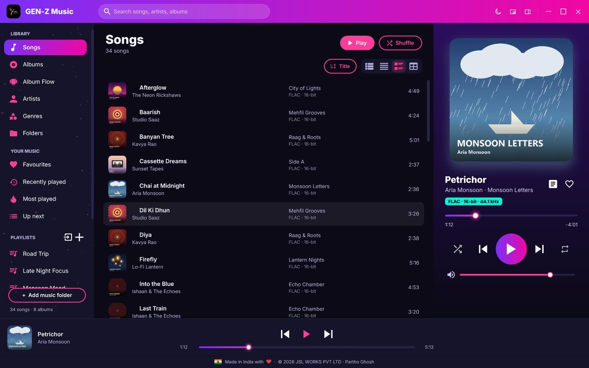
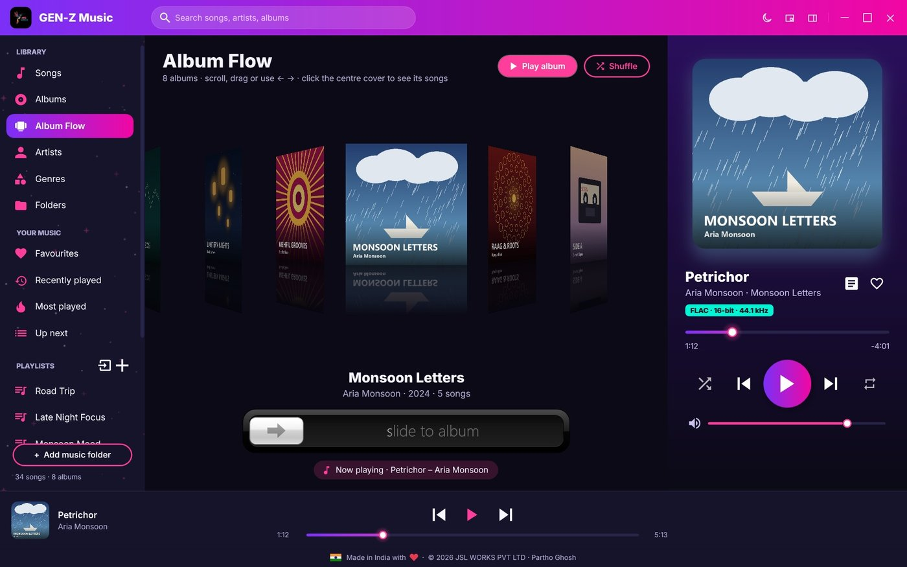
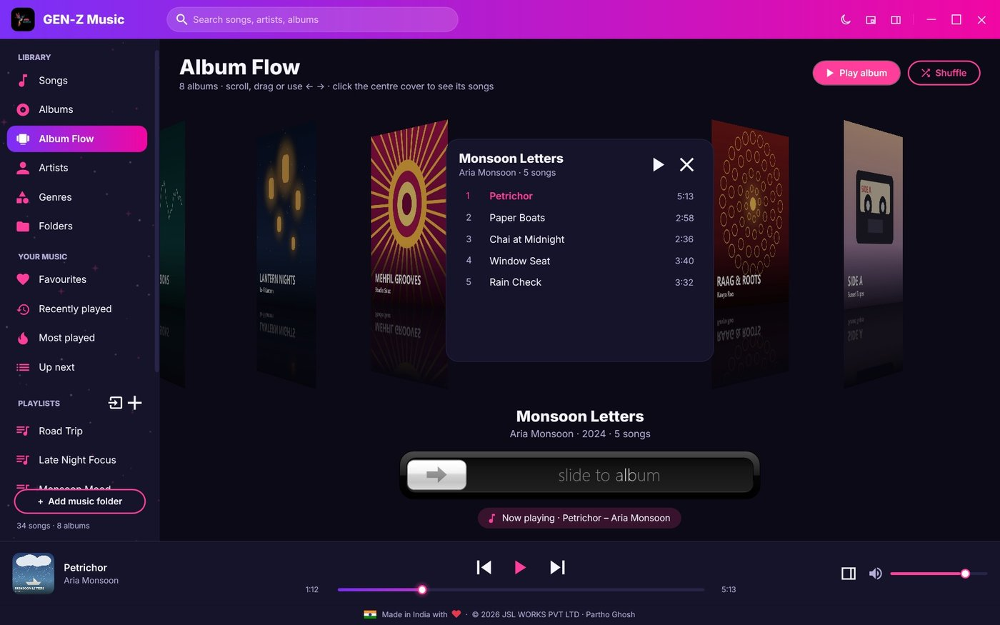
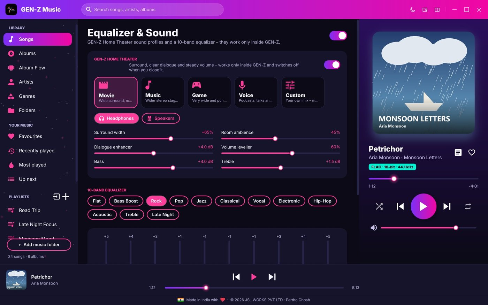
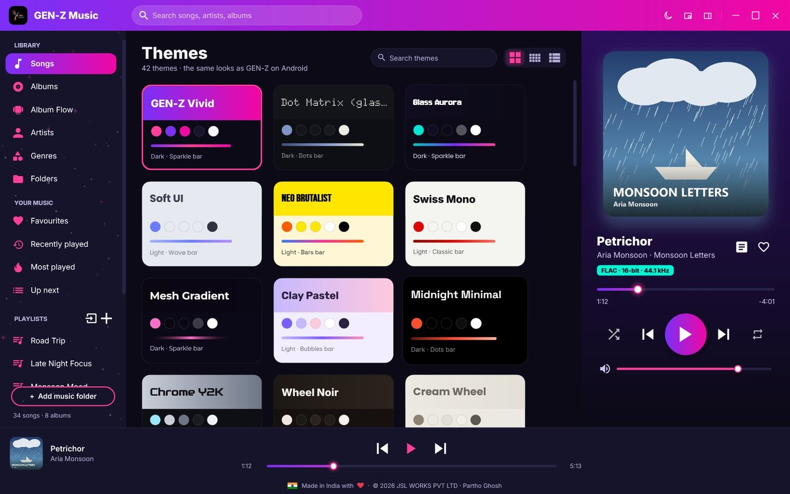
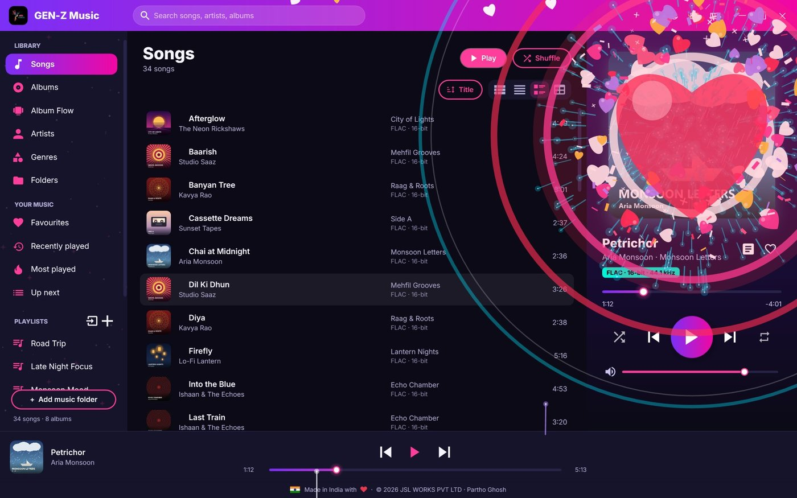
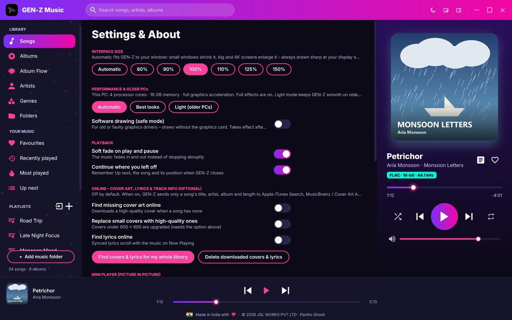

# GEN-Z Music for Windows

**Offline music player for Windows 7, 8, 8.1, 10 and 11**, by **JSL WORKS PVT LTD**.
Designed & developed by Partho Ghosh · Made in India with ♥ · [www.jslworks.in](https://www.jslworks.in/)

The Windows edition of [GEN-Z Music for Android](https://github.com/founderjslworks/jslw-genz-music-player): the same 42 themes, fonts and animations, built natively with WPF.



## Download

Get the latest **GEN-Z-Music-Setup-x.y.z.exe** from [Releases](../../releases) or from [www.jslworks.in/android-devlopment](https://www.jslworks.in/android-devlopment).

1. Run the Setup file.
2. If Windows shows *"Windows protected your PC"*, click **More info › Run anyway** (the app is not code-signed yet).
3. Accept the Terms and Conditions, choose *for me only* (no admin needed) or *all users*, and install.

GEN-Z Music then appears in the Start menu and in **Settings › Apps**, where it can be uninstalled.
A portable zip is also available; it runs from any folder without installing.

📘 **User guide:** [GEN-Z Music for Windows – The Complete User Guide (PDF)](docs/GEN-Z-Music-for-Windows-User-Guide.pdf)

## System requirements

| | Minimum (older PCs) | Recommended |
|---|---|---|
| Windows | 7 SP1, 8 or 8.1 (32- or 64-bit) | 10 or 11 |
| .NET | Framework 4.8 (Setup links to it if missing) | built into Windows 10 (1903+) and 11 |
| Processor | 1 GHz, 1–2 cores | 2 GHz, 4 cores or more |
| Memory | 2 GB RAM | 4 GB or more |
| Graphics | any – software drawing works without a graphics card | DirectX 9 or later (WDDM) |
| Screen | 1024 × 768 | 1920 × 1080 or more · 4K and 120/144/240 Hz supported |
| Disk | about 15 MB | – |

On older PCs GEN-Z switches itself to **Light mode** (Settings & About › Performance & older PCs): no star field or scroll effects, simple fades, capped frame rate and lighter cover scaling. A **software-drawing safe mode** helps with old or faulty graphics drivers (or start once with `--safe`).

## Features

- **Library:** songs, albums, artists, genres, folders, favourites, recently played, most played, search
- **Album Flow:** the 3D album carousel from Android – tilted covers with reflections, mouse wheel / drag / arrow keys, a *slide to album* bar, flip a cover to see and play its songs. Hiding Now Playing brings it to the centre.
- **View options on every page:** songs as list, compact, with covers or details (sortable columns); albums, artists, genres and folders as large grid, small grid, list or details; themes as cards, small cards or list, with theme search
- **Playlists:** create, rename, delete, drag songs onto them, import/export M3U & M3U8
- **Up next:** play next, add to queue, drag to reorder, save as playlist, resume where you left off
- **Synced lyrics:** `.lrc` files, lyrics in the tags or (optional) online; click a line to jump there
- **Tag editor:** title, artist, album, album artist, genre, year, track, lyrics, high-quality cover
- **Sound:** GEN-Z Home Theater (Movie, Music, Game, Voice, Custom – surround width, room, dialogue, leveller) and a 10-band equalizer with 12 presets and automatic headroom
- **Optional online look-ups:** high-quality cover art, synced lyrics and track info (iTunes Search, MusicBrainz / Cover Art Archive, LRCLIB) – off by default
- **42 themes** shared with the Android app, each with its own fonts and progress bar
- **Android motion set** at your monitor's refresh rate (60–240 Hz): screen transitions, 13 list scroll animations, like celebrations (particle explosion, 3D heart frame, glitter heart), sidebar space effects, live volume sliders with particles
- **Mini player:** picture-in-picture, always on top, animated cover
- **Desktop integration:** media keys, taskbar buttons and progress, "Open with GEN-Z Music", drag & drop from Explorer
- **Sharp everywhere:** per-monitor DPI and automatic interface size, crisp on 4K
- **Formats:** MP3, FLAC (incl. 24-bit hi-res), WAV, AIFF, M4A/AAC, WMA
- **Privacy:** works offline, no ads, no tracking, no account

| | |
|---|---|
|  |  |
|  |  |
|  |  |

## Keyboard

| Keys | Action |
|---|---|
| Space | Play / pause |
| Ctrl + → / ← | Next / previous |
| Ctrl + F | Search |
| Ctrl + L | Lyrics |
| Ctrl + I | Song info & tags |
| Ctrl + N | New playlist |
| Ctrl + P | Mini player |
| Delete | Remove from Up next / playlist |
| Alt + ← / mouse back button | Back |
| ← → Home End · Enter · Esc | Album Flow: browse · flip / play (Ctrl+Enter) · flip back |

## Building from source

Requires Windows with the .NET SDK (6 or later) and the .NET Framework 4.8 developer pack.

```
dotnet build GenZ.Desktop/GenZ.Desktop.csproj -c Release
```

The installer is built with [Inno Setup 6.7+](https://jrsoftware.org/isinfo.php): `ISCC /DAppVersion=1.5.4 installer\genz.iss` (output in `dist\`).

**GitHub Actions** (`.github/workflows/build.yml`): every push to `main` builds the app, starts it once as a smoke test, and packages the portable zip and the installer (*Actions* tab → latest run → *Artifacts*).
To publish a release, tag the version: `git tag v1.5.4 && git push --tags` – the installer and zip are attached to a new GitHub release.
`guide-shots.yml` (run manually) builds a demo library with invented songs and covers and captures every screen for the user guide.

### Project layout

| Folder | Contents |
|---|---|
| `GenZ.Desktop/` | WPF app (C#, .NET Framework 4.8) |
| `installer/` | Inno Setup script, Terms and Conditions (EULA), third-party notices, golden-horizon wizard art |
| `shared/` | Themes, fonts and licences shared with the Android app |
| `tools/` | Demo library generator for screenshots (invented songs, art and lyrics) |
| `docs/` | User guide (PDF) and screenshots |

## Licence

Proprietary – © 2026 JSL WORKS PVT LTD. All rights reserved. The source is published for viewing only; see [LICENSE](LICENSE).
Open-source components (CSCore – MS-PL, TagLib# – LGPL-2.1, Newtonsoft.Json – MIT, Google Fonts – OFL 1.1, XuiMod animations – Apache 2.0) are listed in `installer/THIRD-PARTY.txt` and in the app under Settings & About › Licences.
